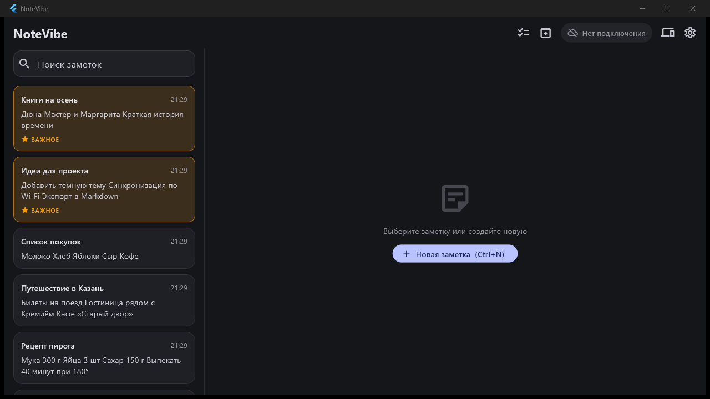
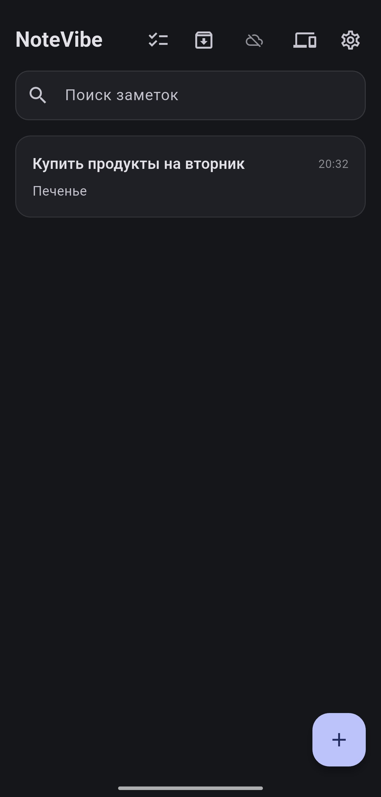

# NoteVibe

Блокнот для Windows и Android. Заметки синхронизируются напрямую между вашими
устройствами по домашней Wi-Fi сети. Облака и регистрации нет, передача шифруется.

  
  

[Последний релиз](https://github.com/Vagamin/NoteVibe/releases/latest) ·
[Все версии](https://github.com/Vagamin/NoteVibe/releases)

## Что умеет

- **Заметки:** форматирование, чек-листы, поиск, важные заметки сверху, архив.
- **Вложения:** фото и файлы до 50 МБ, скачиваются с другого устройства.
- **Синхронизация:** устройства находят друг друга в сети, пара подключается по QR-коду.
- **Безопасность:** шифрование передачи, ключи хранятся в защищённом хранилище системы.
- **Интерфейс:** светлая, тёмная и системная темы, на ПК две панели.

## Установка

Скачайте файл из [последнего релиза](https://github.com/Vagamin/NoteVibe/releases/latest):

| Устройство | Файл |
|---|---|
| Windows | `NoteVibe-<версия>-portable.exe`, установка не нужна |
| Android (современный телефон) | `NoteVibe-<версия>-arm64.apk` |
| Android (старый 32-битный) | `NoteVibe-<версия>-armeabi-v7a.apk` |
| Android-эмулятор на ПК | `NoteVibe-<версия>-x86_64.apk` |

Если не уверены, какой APK выбрать, возьмите `arm64`.

## Первое подключение

1. Запустите приложение на ПК и на телефоне в одной Wi-Fi сети.
2. На ПК: **Устройства → Показать код**.
3. На телефоне: **Устройства → Сканировать** и наведите камеру на QR-код.
   Без камеры введите 6-значный код.

## Документация

* [docs/ARCHITECTURE.md](docs/ARCHITECTURE.md): устройство приложения
* [docs/PROTOCOL.md](docs/PROTOCOL.md): сеть, сопряжение, шифрование
* [docs/BUILD.md](docs/BUILD.md): сборка, запуск, устранение неполадок
* [RELEASE.md](RELEASE.md): порядок выпуска

## Версии

Номер версии `MAJOR.MINOR.PATCH`: новая функция увеличивает `MINOR`,
исправление `PATCH`, глобальное изменение `MAJOR`.
